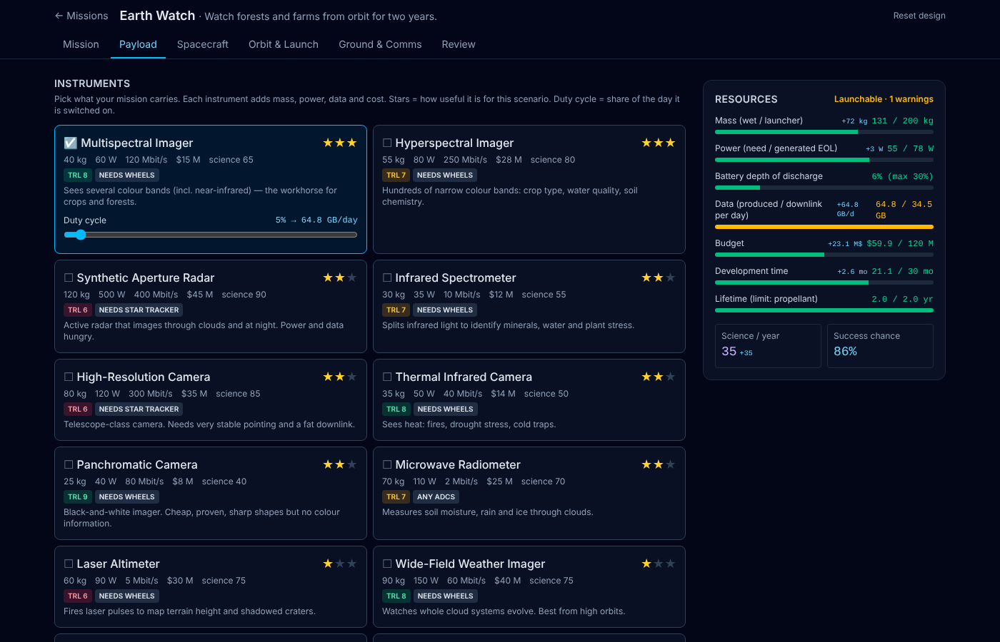
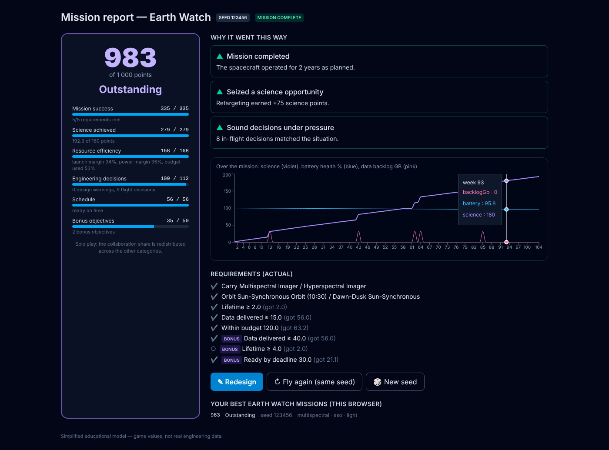

# PP.game — Space Mission Design

Design, launch and fly a space mission under real engineering trade-offs: **mass, power, data, budget, schedule and
lifetime**. Every choice moves at least two of them, and there is never a single right answer.
Inspired by the engineering spirit of Pedro Paulet and by chaos in orbital mechanics (coming in later phases).

> Simplified educational model — game values, not real engineering data.



## Status
| Phase | What | State |
|---|---|---|
| 0 | Scaffold, CI | ✅ |
| 1 | Engine (`evaluateDesign`), live dashboard, Design Review, Earth Watch + Lunar Pathfinder | ✅ |
| 2 | Launch animation, seeded mission simulation, events with team decisions (or bots), score 0–1 000, post-mission analysis | ✅ |
| 3 (part 1) | Your spacecraft drawn from your design (design, launch pad, flight), new launch sequence with telemetry, music per stage, typography | ✅ |
| 3 (part 2) | Career: Paulet-1 prologue, Act 1 contracts, investors, funds & prestige, reusable rockets, hub, lessons, share links | ✅ |
| 3.5 | Act 2: real Earth–Moon three-body physics, transfer routes, chaos lesson, Lagrange Observatory, reusable heavy | ✅ (branch `cloud/fase-1`) |
| 3+ | Campaign with investors, player name, difficulty levels, save/share, hub + intro video, lessons, 3-body module, Paulet legacy, polish | planned |

Live demo: **https://paulet-andes-to-orbit.vercel.app/** (installable, plays offline after the first visit).

## How to play
**Career:** start a new career, fly **Paulet-1** — the sounding rocket built from Pedro Paulet's notebooks — past 100 km, then take contracts from
a space agency, a commercial partner and a foundation. Earn funds and prestige to unlock rideshares and reusable rockets.
**Free mission / Sandbox:** design any scenario without career progress. **Learn:** orbits, the rocket equation and Paulet, facts vs. legend.

### Designing a mission
1. Pick a mission (Earth Watch is the beginner one).
2. **Payload:** add instruments and set their duty cycle — watch the meters on the right react (with +/− deltas).
3. **Spacecraft / Orbit & Launch / Ground & Comms:** size arrays and battery, pick pointing, propulsion, orbit, launcher, radio and ground stations.
4. **Review:** red items block launch, amber ones are risky or wasteful; each explains *why* and *what to change*.
5. **Launch** with a seed (same design + same seed + same decisions = same mission), then fly: answer events as your team
   (Mission Director, Spacecraft Engineer, Astrophysicist, Astrobiologist) or delegate roles to bots.
6. **Mission report:** score out of 1 000, the three main reasons for the result, and what to change next time.

You play **Dr. Pedro Goicochea**, a fictional physicist from Arequipa inspired by the story of Pedro Paulet.



## Run locally
```bash
npm install
npm run dev
npm test
```

## Design decisions
- The simulation engine (`src/engine/`) is pure, deterministic TypeScript with no UI dependency — testable and reusable.
- All formulas and constants: [`docs/model.md`](docs/model.md). Decisions and assumptions: [`DECISIONS.md`](DECISIONS.md).
- Components and launchers are generic and fictional on purpose.

## Known limitations
- Two-body circular orbits, daily-average data and power; no real link-budget or thermal analysis.
- Weekly simulation with simplified event models; balance is first-pass.

## Credits
Fonts, music and sound credits: [`CREDITS.md`](CREDITS.md).

## License
MIT — see [LICENSE](LICENSE).
